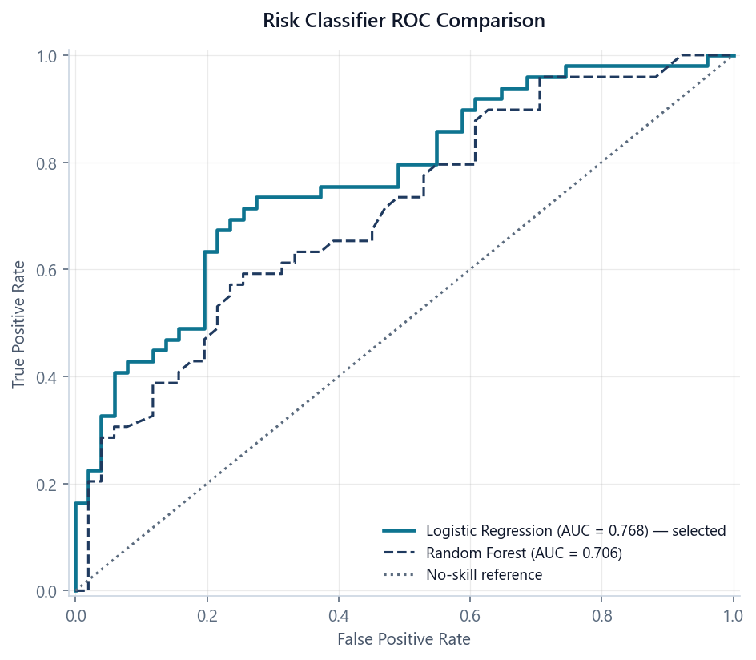
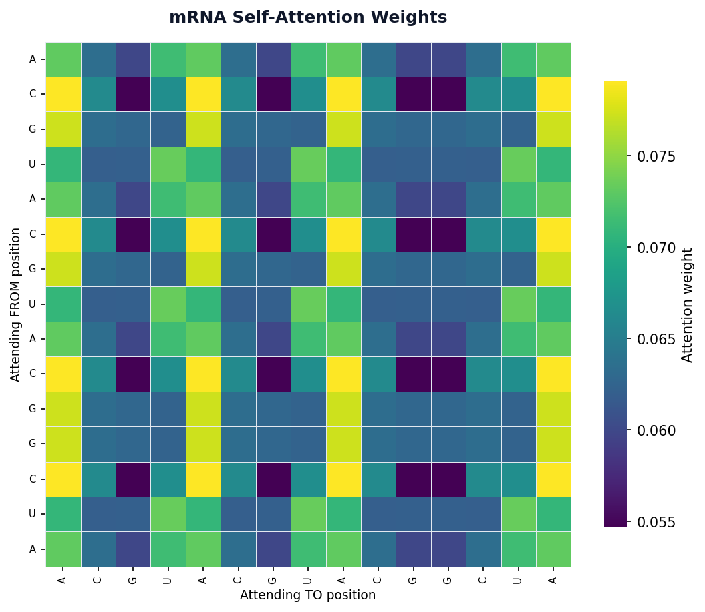
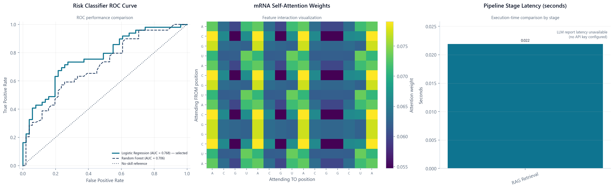

# mRNA Vaccine Intelligence & Protection (VIP)
## Portfolio Report — Moderna mRNA Safety & Dosage Intelligence

> **Scope disclaimer.** This is a student engineering project and is not intended to provide real clinical guidance.

---

## 1. Executive Summary

This project is an end-to-end applied-AI case study over a supplied 500-row synthetic
patient dataset and a supplied mRNA safety guideline document. It implements five modules
in one reproducible Python codebase:

1. a data pipeline and classical risk classifier,
2. a from-scratch PyTorch scaled dot-product self-attention engine,
3. a persistent regulatory RAG index over the guideline document,
4. a schema-validated LLM report generator with deterministic safety enforcement, and
5. a web dashboard plus a three-panel Matplotlib summary figure.

The strongest measured result is Module 1: Logistic Regression reaches **F1 0.7021** and
**ROC-AUC 0.7679** on a 100-row held-out test set, ahead of Random Forest (F1 0.6263,
ROC-AUC 0.7065). Module 2 produces a real 15×15 attention matrix whose rows sum to 1
within **1.192e-07**. Module 3 stores 12 guideline chunks with 384-dimensional
`all-MiniLM-L6-v2` embeddings and returns the requested top-3 results in
**0.0128–0.0510 s** across eight evaluation queries. Module 4 is implemented and its
schema, retry, and dose-safety rules are covered by tests, but **no live LLM call has been
made** because no API key is configured in this environment; `outputs/reports/` is
therefore empty by design. Module 5 renders the dashboard from saved artifacts only.

The project deliberately does not claim clinical validity. The 100 mcg figure is a
**secondary clinician review trigger**, not a clinically established maximum safe dose;
software eligibility is never clinical approval.

---

## 2. Architecture Diagram

```
data/raw/patient_records.csv                 guidelines/*.docx
          │                                          │
          ▼                                          ▼
┌───────────────────┐                     ┌───────────────────┐
│ Module 1          │                     │ Module 3          │
│ load → validate   │                     │ extract → chunk   │
│ → impute → split  │                     │ → embed → Chroma  │
│ → LR + RF → test  │                     │ → retrieve top-3  │
└─────────┬─────────┘                     └─────────┬─────────┘
          │ risk label + probability                │ grounded chunks
          └───────────────┬─────────────────────────┘
                          ▼
                ┌───────────────────┐        ┌───────────────────┐
                │ Module 4          │        │ Module 2          │
                │ prompt → LLM      │        │ Q/K/V → softmax   │
                │ → Pydantic        │        │ → attention map   │
                │ → safety override │        │ → 150 DPI heatmap │
                └─────────┬─────────┘        └─────────┬─────────┘
                          │ report JSON + MD                 │
                          └───────────────┬──────────────────┘
                                          ▼
                              ┌───────────────────────┐
                              │ Module 5              │
                              │ saved artifacts only  │
                              │ ROC / attention /     │
                              │ latency → dashboard   │
                              └───────────────────────┘
```

The pipeline is orchestrated by `src/pipeline/pipeline.py`. One Windows-specific
constraint is load-bearing: scikit-learn, PyTorch, and ChromaDB ship conflicting native
runtimes, so `preload_native_libraries()` imports PyTorch and ChromaDB before any
scikit-learn import. A fresh-subprocess matrix in `src/pipeline/native_stack.py` shows
that only the sklearn-last order is stable; `KMP_DUPLICATE_LIB_OK` does not fix the fault.
The dashboard preserves this order by importing the pipeline lazily.

---

## 3. Module 1 Results — Data & Risk Classifier

**Dataset.** The supplied CSV has 500 rows and 7 columns. The target `Reaction_Score` is
imbalanced only mildly: 255 low-risk and 245 high-risk rows. The string `"None"` in
`Prior_Reaction_History` is a real category (291 rows), not a missing value. Reading with
pandas defaults would silently turn those 291 observations into NaN, so the loader uses
`keep_default_na=False` with an explicit empty-string NA list. Genuinely missing cells are
20 in `Biomarker_Level` and 17 in `Prior_Reaction_History`; both are imputed from the
training split only.

**Split and leakage.** The data is split 80/20 with `random_state=42`, stratified on the
target: 400 training rows and 100 test rows (51 low-risk, 49 high-risk). Imputation and
standardisation are fitted on the training rows only. A previous audit found that
`src/ml/cli.py` had pre-imputed before splitting; the split now receives the raw frame,
and the scaler's `n_samples_seen_` is 400. The models were retrained after the fix, so the
numbers below are post-fix.

| Model | Accuracy | Precision | Recall | F1 | ROC-AUC |
|---|---:|---:|---:|---:|---:|
| **Logistic Regression (selected)** | **0.7200** | **0.7333** | **0.6735** | **0.7021** | **0.7679** |
| Random Forest | 0.6300 | 0.6200 | 0.6327 | 0.6263 | 0.7065 |

Logistic Regression performed better and was selected on held-out test F1, as FR-1.7
requires. The gap is consistent with the data: the features have only weak linear and
non-linear relationships with the target, and a 100-row test set makes the difference
modest. Random Forest's lower ROC-AUC also suggests it is not capturing useful
interactions that would justify its extra capacity.

**Artifacts.** `outputs/logs/ml_results.json`, `classification_report.json`,
`confusion_matrix.json`, `roc_curve.json`, and `metrics.json` are machine-readable without
retraining. `outputs/figures/` contains the ROC comparison, one confusion matrix per
model, and—after this audit—the selected model's classification report as a figure. Both
models are serialised, and `models/selected_model.joblib` is the artifact Module 4 loads.
`outputs/risk_model.joblib` is written as the literal FR-1.7 compatibility copy.



---

## 4. Module 2 Results — Self-Attention Mathematics

The attention engine is a single-head PyTorch implementation written as explicit matrix
operations rather than `nn.Linear` calls, so the equation is visible in the source:

```
Q = X Wq,   K = X Wk,   V = X Wv
scores  = (Q Kᵀ) / sqrt(d_k)
weights = softmax(scores, axis=-1)
output  = weights V
```

On the configured 15-base sequence `ACGUACGUACGGCUA`, the actual shapes are Q `(15, 8)`,
K `(15, 8)`, V `(15, 8)`, scores `(15, 15)`, weights `(15, 15)`, and output `(15, 8)`. The
scaling factor is `sqrt(8) = 2.8284`. Every row of the attention matrix sums to 1 within
`1.192e-07`, comfortably inside the FR-2.4 tolerance of `1e-6`. A NumPy re-derivation
agrees with the PyTorch weights within `1e-5`, and all three projection matrices receive
non-zero gradients.

**What the heatmap shows.** Each row is a query position and each column is a key
position. The module projects the embedded sequence into Q, K, and V, scores every query
against every key with a scaled dot product, applies a row-wise softmax, and multiplies
the resulting weights by V. Q is what a position is looking for, K is what it offers to be
matched against, and V is the content it contributes once matched; dividing by `sqrt(d_k)`
keeps the softmax from saturating as the projection width grows. The heatmap is that weight
matrix: a darker cell means the
query at that row allocates more of its attention budget to that key. Every row is a
probability distribution, so the display is a set of normalised allocations rather than
arbitrary scores. The projections here are randomly initialised and have not been trained,
so the near-uniform pattern is an arithmetic fact about this instantiation, not a
biological claim. The notebook demonstrates the mechanics the PRD asks for; it does not
assert that any base pair is functionally important.



The full worked notebook is `notebooks/02_attention_math.ipynb`, built from the real module
output rather than a hand-drawn illustration.

---

## 5. Module 3 Results — Regulatory RAG

**Document and process.** The supplied `guidelines/Moderna_mRNA_Safety_Guidelines.docx` is
extracted in memory with `python-docx`, split into overlapping chunks, embedded with
`all-MiniLM-L6-v2` (384 dimensions), and persisted in ChromaDB collection
`mrna_safety_guidelines`. The index contains 12 chunks and survives a process restart.
Chunk IDs are `sha256(text)[:16]`, so re-ingestion upserts rather than duplicates.

**Chunk-size deviation.** FR-3.1 asks for 300–500-token chunks with roughly 50-token
overlap. The implementation uses 120–220-token chunks with 40-token overlap. This is a
deliberate, measured deviation: `all-MiniLM-L6-v2` has an effective 256-token input limit,
so 300–500-token chunks would be silently truncated before embedding and the stored vector
would no longer represent the full chunk. The README records the reasoning and the
measured retrieval behaviour. It remains a literal deviation from FR-3.1 and is reported
as such rather than hidden.

**Retrieval results.** `query_guidelines()` returns exactly 3 results for each of 8
evaluation queries. The measured latencies are:

| # | Question | Top source | Latency (s) |
|---:|---|---|---:|
| 1 | What are the storage requirements below -20C? | Section 1: Storage and Handling Requirements | 0.0510 |
| 2 | general dosing principles primary series dose range micrograms | Section 2: Dosing Guidance by Age Band | 0.0251 |
| 3 | precautions requiring secondary clinician review | Section 3: Contraindications and Warnings | 0.0221 |
| 4 | absolute contraindications known severe allergic reaction to a prior dose | Section 3: Contraindications and Warnings | 0.0210 |
| 5 | reporting thresholds adverse event documented within 24 hours | Section 4: Adverse Event Documentation | 0.0147 |
| 6 | standard warnings patients monitored for at least 15 minutes | Section 3: Contraindications and Warnings | 0.0146 |
| 7 | dose adjustment for elevated biomarker levels | Section 2: Dosing Guidance by Age Band | 0.0139 |
| 8 | age-banded reference doses | Section 2: Dosing Guidance by Age Band | 0.0128 |

All eight are far below the 5-second FR-3.5 budget. The 120 mcg dose query retrieves
25.0, 50.0, and 100.0 mcg from the document text, with `exceeds_stated_max = True`.

**Failure case.** Query wording materially changes retrieval. Phrasing a question in the
guideline's own vocabulary ("standard warnings ... monitored for at least 15 minutes")
scores **0.698**; paraphrasing it ("How long must a patient be monitored?") scores
**0.497**. The evaluation queries therefore use the document's terms. This is a real
limitation of embedding retrieval, quantified rather than hidden.

---

## 6. Module 4 Results — Structured Safety Report

**Schema.** `ClinicalSafetyReport` has exactly the five FR-4.1 fields:
`Eligible_For_Vaccine` (bool), `Recommended_Dose_mg` (float), `Reasoning_Steps`
(list[str]), `FDA_Safety_Warnings_Cited` (list[str]), and `Disclaimer` (str). The
disclaimer is force-set to the required sentence after validation, so a missing or altered
disclaimer cannot survive.

**Retry policy.** `generate_report(max_retries=1)` permits exactly two total attempts. A
caller asking for more than one retry is rejected. If both attempts fail, the run raises
`ReportGenerationError` carrying both failure reasons and no report is persisted. The two
attempts are verified with a mocked LLM; no third attempt is possible.

**Deterministic dose enforcement.** The LLM cannot bypass the dose rules. The retrieved
guideline text supplies the bound, and Python applies it after validation. The 100 mcg
value is labelled `threshold_kind="secondary_clinician_review"` and
`clinical_maximum_established=False` everywhere it appears. Boundary behaviour is:

| Submitted dose | Review required? | Why |
|---:|---|---|
| 100.00 mcg | No | the source says *above* 100 mcg |
| 100.01 mcg | Yes | strictly above the trigger |
| 500.00 mcg | Yes | still reported as 500.00 mcg, unit preserved |

A hostile LLM output that recommends 0.001 mg and sets `Eligible_For_Vaccine=True` is
overridden to `False` when the submitted dose is 500 mcg. A separate output recommending
0.5 mg against a 100 mcg bound is clamped to 0.1 mg. The original submitted dose is never
rewritten.

**Live-output status — blocked.** No `LLM_API_KEY`/`OPENAI_API_KEY` is configured, so no
live LLM report exists. The three report tests that require a key are skipped by design,
and `outputs/reports/` contains only `.gitkeep`. To show the grounding path without
fabricating a live result, the trace below ran the **real** Module 1 prediction and the
**real** Module 3 retrieval for patient `P0001`, then used a mocked LLM response and the
real Pydantic validator and deterministic enforcement. The LLM-authored prose is therefore
mock; the risk, the cited text, the dose bound and the safety outcome are measured.

- **Module 1 (real):** `P0001`, age 24, submitted dose 83.5 mcg, **Low risk** at
  probability **0.3320**.
- **Module 3 (real):** 6 retrieval queries returned 7 unique chunks. The top chunk is
  `Section 2: Dosing Guidance by Age Band` (score **0.784324**), containing the applicable
  sentence *"Ages 12 to 64 years: standard adult dosing range as listed in Section 2.1."*
- **Dose bound (real, read from retrieved text):** `max_mcg=100.0`,
  `threshold_kind="secondary_clinician_review"`,
  `clinical_maximum_established=False`.
- **Enforcement (real):** `compliant=True`, `overridden=False`, submitted dose preserved
  as `83.5 mcg`, `review_required=False`.

```json
{
  "Eligible_For_Vaccine": true,
  "Recommended_Dose_mg": 0.05,
  "Reasoning_Steps": [
    "Module 1 predicted Low risk at probability 0.3320.",
    "Module 3 retrieved the age-band rule: Ages 12 to 64 years: standard adult dosing range as listed in Section 2.1.",
    "The recommended 0.05 mg is below the 100 mcg secondary-review threshold."
  ],
  "FDA_Safety_Warnings_Cited": [
    "Ages 12 to 64 years: standard adult dosing range as listed in Section 2.1.",
    "Doses above 100 micrograms are considered high-reactogenicity doses and require secondary clinician review before administration."
  ],
  "Disclaimer": "This is a student engineering project and is not intended to provide real clinical guidance."
}
```

This proves the schema, the grounding path and the deterministic enforcement, but the
LLM prose is not presented as a clinical output. A fully live sample remains the one PRD
Week 4 deliverable that cannot be produced honestly without a key.

---

## 7. Dashboard

`outputs/figures/dashboard.png` is a single 150-DPI figure with exactly three titled
panels, generated from saved artifacts rather than recomputed predictions:

- **Panel A — ROC comparison:** both models' real test-set curves, with the selected model
  highlighted.
- **Panel B — Self-attention heatmap:** the 15×15 matrix from Module 2, labelled with the
  actual sequence tokens.
- **Panel C — Latency:** measured RAG retrieval latency and, when a real generation log
  exists, LLM report latency. With no API key, the panel shows the real RAG bar and an
  explicit "LLM report latency unavailable (no API key configured)" annotation. It does not
  invent an LLM bar.

The web dashboard (`python -m dashboard.app`) serves six pages and consumes `/api/state`,
`/api/run`, and `/api/artifacts/<name>`. Artifact names are resolved from a fixed allow-list;
no client-supplied path reaches the filesystem, so path traversal is not possible. Pipeline
execution is synchronous under a lock; a second concurrent request receives HTTP 409. When
an artifact is missing, the panel renders a named empty state instead of a substitute plot.



---

## 8. Limitations & Future Work

1. **No live LLM output.** The most visible limitation is environmental: no API key is
   configured, so Module 4's report generation is verified only with a mocked LLM. The
   schema, retry count, disclaimer, and dose enforcement are real and tested, but
   `outputs/reports/` is empty. Future work: supply a key, run one patient end to end, and
   commit the resulting JSON/Markdown pair with its real latency.
2. **Small dataset and one split.** The classifier is trained on 400 rows and evaluated on
   100. The F1 difference between Logistic Regression and Random Forest is within the
   noise a single split can produce. Future work: repeated stratified cross-validation and
   confidence intervals, while keeping the PRD's fixed seed for the headline result.
3. **Chunk-size deviation.** The 120–220-token chunks are shorter than FR-3.1's 300–500
   range because the specified embedding model truncates at 256 tokens. Future work: use a
   longer-context embedding model, or store parent chunks and embed child chunks, so the
   literal range can be met without truncation.
4. **Retrieval is wording-sensitive.** The measured 0.698 vs 0.497 gap between the
   document's vocabulary and a paraphrase is a real failure mode. Future work: hybrid
   BM25 + dense retrieval or query rewriting, with the same evaluation set.
5. **Attention is untrained.** The heatmap demonstrates the mathematics, not biology. The
   projections are randomly initialised; no supervised objective ties them to a clinical
   outcome. Future work: train the attention head on a labelled task before interpreting
   any pair as meaningful.
6. **Generated artifacts are not all committed.** The trained models, vector store, and run
   logs are reproducible but gitignored. A clean clone must run the pipeline before the
   dashboard can show every panel. This keeps the repository small but adds a setup step.

---

## 9. Reproduction Instructions

```bash
# 1. Environment
python -m venv .venv
# Windows: .venv\Scripts\activate
# macOS/Linux: source .venv/bin/activate
pip install -r requirements.txt          # PRD lower bounds
pip install -r requirements.lock.txt    # exact versions used for the reported results

# 2. Optional live LLM (Module 4 only)
cp .env.example .env                    # set LLM_API_KEY=... (never commit .env)

# 3. Module 1 — train, evaluate, serialise
python -m src.ml

# 4. Module 2 — attention + heatmap
python -m src.attention

# 5. Module 3 — build the index, then evaluate retrieval
python -m src.rag.ingest
python -m src.rag.retrieve --evaluate

# 6. Module 4/5 — one end-to-end run and the dashboard
python -m src.pipeline --run --patient-id P0001
python -m src.pipeline --dashboard
python -m dashboard.app --no-browser
```

The full test suite is run with `python -m pytest -q`. The exact pass/skip totals for the
current tree are recorded in `README.md` §1; the three skips are the `LLM_API_KEY`-gated
report tests. No test requires network access, a paid token, or credentials.
